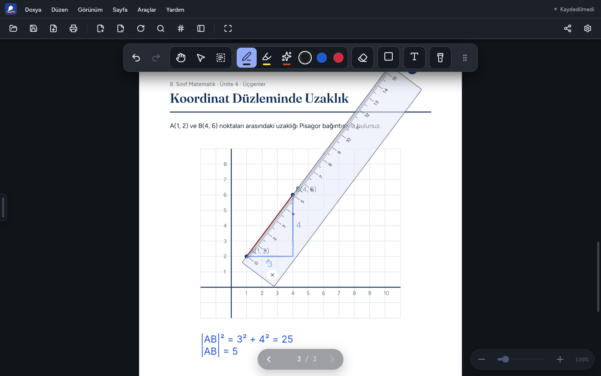
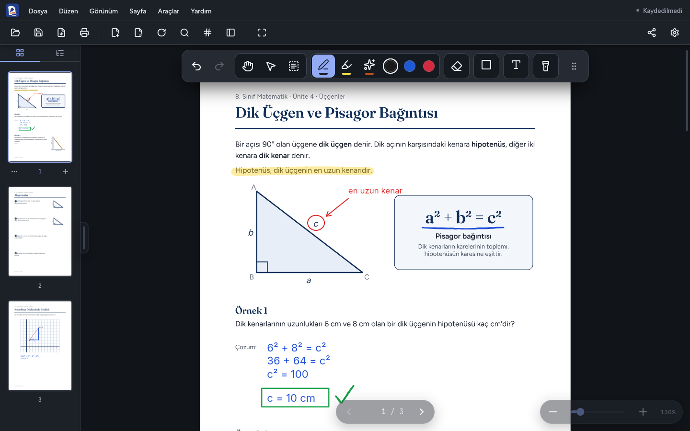
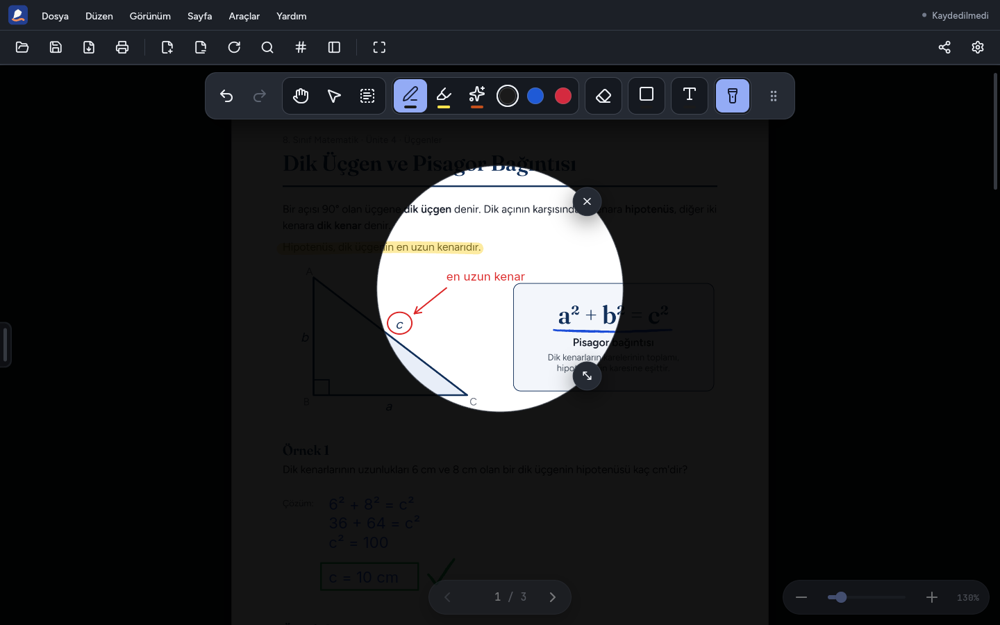
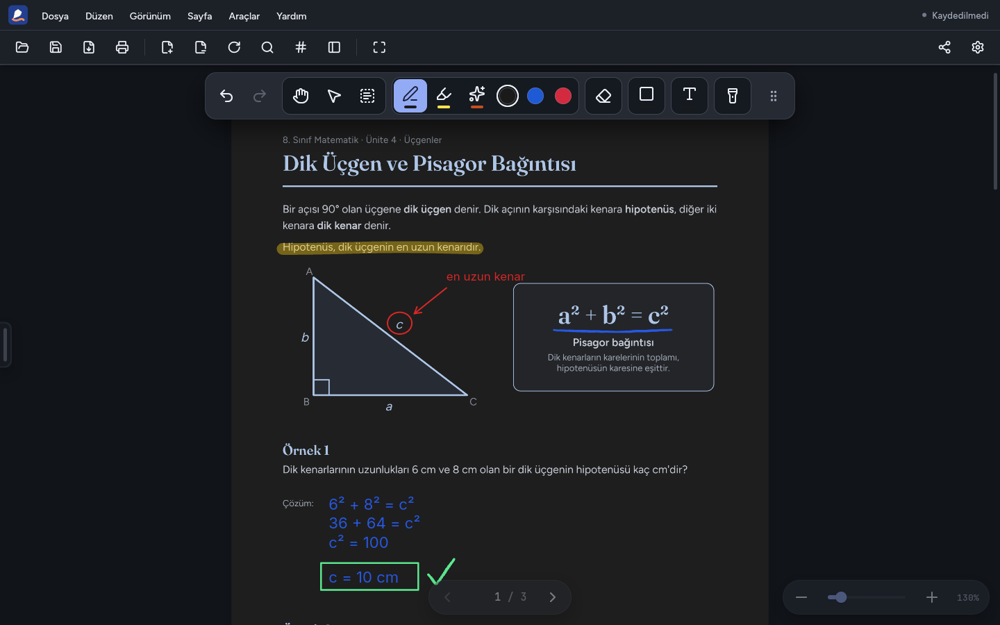
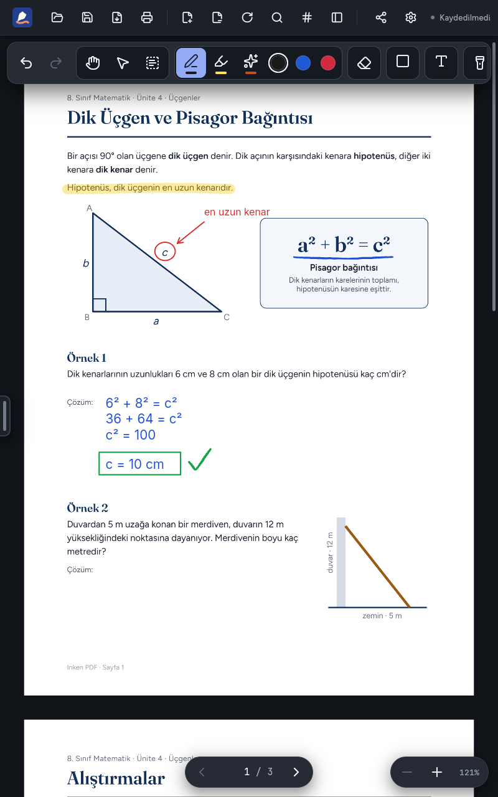
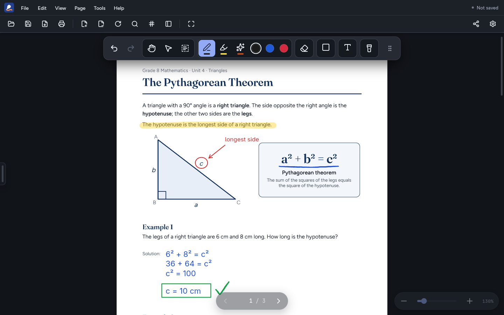

<p align="center">
  
</p>

<h1 align="center">Inken PDF</h1>

<p align="center">
  <b>Hafif, hızlı, ücretsiz PDF okuyucu; üzerine yazıp çizebildiğin.</b><br>
  Windows · Linux (Pardus, Debian, Ubuntu, Arch) · Android
</p>

<p align="center">
  <a href="https://github.com/okolyigit/inken-pdf/releases/latest"><b>İndir</b></a> ·
  <a href="#english">English</a> ·
  <a href="https://github.com/okolyigit/inken-pdf/issues">Geri bildirim</a>
</p>

<p align="center">
  
</p>

Inken PDF her gün kullanacağın PDF okuyucu olarak tasarlandı. Hızlı açılır, telefonu yormaz, üzerine yazıp çizmek de bir dokunuş uzakta.

- **Herkes için:** hafif ve hızlı bir PDF okuyucu. Kurulum paketi yaklaşık 15 MB; büyük dosyalar bile beklemeden açılır, sayfalar akıcı kayar. Metinde arama, içindekiler ve parolalı PDF'ler de var.
- **Öğrenciler için:** ders notunun önemli yerini fosforluyla işaretle, kenarına not al, çalışma kâğıdındaki soruyu doğrudan üzerinde çöz. Cetvel, gönye, iletki, pergel ve koordinat düzlemi geometri ve grafik sorularında hazır.
- **Öğretmenler için:** akıllı tahtada PDF üzerinde ders anlat. Spot ışığı, perde, tam ekran ve gerçek boyutlu ölçme araçları ders sırasında hazır.

Çizimler **PDF'in içine**, her PDF okuyucuda görünecek biçimde kaydedilir ve Inken'de yeniden açınca düzenlenebilir kalır. Orijinal dosyanın üzerine sessizce yazılmaz.

**Tamamen ücretsiz ve açık kaynak.** Hesap açman ya da oturum açman gerekmez. Reklam yok, veri toplama yok; uygulama internete bile bağlanmaz, dosyaların cihazında kalır. Telefonda, tablette, dizüstünde ve akıllı tahtada aynı uygulama.

> **Deneme sürümü.** Inken PDF beta aşamasında ve hatalar olabilir. Uygulama orijinal dosyanın üzerine sessizce yazmaz ve otomatik yedek alır; yine de önemli dosyalarının bir kopyasını ayrıca sakla. Inken PDF **hiçbir garanti olmadan** sunulur; dosya ya da veri kaybından geliştirici sorumlu tutulamaz ([GPL-3.0](LICENSE), madde 15–16). Karşılaştığın sorunları uygulamada **Ayarlar → Hakkında → Hata bildir** ile ya da [Issues](https://github.com/okolyigit/inken-pdf/issues) bölümünden bildirirsen çok sevinirim.

## Neler yapabilirsin

|  |  |
|---|---|
|  |  |
| **Ölçme araçları:** cetvel, gönye, iletki ve pergel gerçek boyutludur; kenar boyunca düz çizgi ve yay çizilir. | **Sayfa paneli:** küçük resimler; sayfa ekle (kareli, noktalı, çizgili, koordinat), döndür, sil. |
|  |  |
| **Spot ışığı ve perde:** sayfanın bir yerini aydınlat ya da perdeyle adım adım aç. | **Gece modu:** koyu zemin, okunur çizimler; kaydedilen dosya değişmez. |

### Çizim
- **Kalem** (basınca duyarlı), **fosforlu**, bir süre sonra kendiliğinden silinen **geçici kalem**, **silgi** (bütün çizgi ya da parça)
- **Şekiller:** çizgi, ok, dikdörtgen, elips, koordinat düzlemi
- **Metin** ve panodan **görsel yapıştırma**
- **Seçme:** taşı, boyutlandır, rengini değiştir, kopyala / yapıştır, başka sayfaya taşı

### Ders sırasında
- Tam ekran, spot ışığı, perde, gece modu
- Ekranın dört kenarından birine taşınabilen araç kutusu
- **Akıllı tahta:** büyük arayüz (%125 / %150), parmak ile kalem ayrımı

### Okuma
- Metinde arama (Türkçe I / ı / İ / i ayrımı yapmadan), metin seçip kopyalama
- İçindekiler, bağlantılar, sayfaya / genişliğe sığdırma
- Parolalı PDF'ler

### Dosya
- Kayıt PDF'in içinde, **otomatik yedek**
- Çizimleri gömülü dışa aktarma, yazdırma, paylaşma
- Türkçe ve İngilizce arayüz

<p align="center">
  
</p>

## Kurulum

[Son sürüm sayfasından](https://github.com/okolyigit/inken-pdf/releases/latest) sistemine uygun dosyayı indir.

| Sistem | Dosya | Kurulum |
|---|---|---|
| **Windows** 10 / 11 | `InkenPDF-Kurulum-*.exe` | Çalıştır. Windows "bilgisayarınızı korudu" derse **Ek bilgi → Yine de çalıştır**. Kurulum istemiyorsan `InkenPDF-tasinabilir-*.zip`. |
| **Pardus / Debian / Ubuntu** | `inken-pdf_*_amd64.deb` | `sudo apt install ./inken-pdf_*_amd64.deb` |
| **Arch / CachyOS** | `inken-pdf-*.pkg.tar.zst` | `sudo pacman -U inken-pdf-*.pkg.tar.zst` |
| **Android** | `InkenPDF-*-arm64.apk` | Telefon ve tabletlerin çoğu için; eski cihazlarda `-armv7.apk`. "Bilinmeyen kaynaklardan yükleme" izni istenir. |

## Nasıl kaydeder

Inken'in kaydettiği dosya sıradan bir PDF'tir. Her çizim, kendi görünümüyle bir PDF açıklaması (annotation) olarak yazılır; bu yüzden Adobe Reader, Firefox, Okular ya da telefondaki herhangi bir okuyucu çizimleri görür. Inken ayrıca düzenlenebilir katmanı PDF'e ek olarak koyar; dosyayı yeniden açınca çizimler tek tek seçilip değiştirilebilir. Ayrıntı: [`docs/format.md`](docs/format.md).

## Geliştirme

Flutter ile tek kod tabanı.

| Klasör | İçerik |
|---|---|
| `apps/inken` | Flutter uygulaması (arayüz, Riverpod) |
| `packages/inken_core` | Saf Dart: çizim modeli, geri al / yinele, geometri, `inken.json` |
| `packages/inken_pdf` | pdfrx ile görüntüleme, PDFium ile yazma / okuma |
| `docs/` | Kayıt formatı, ekran görüntüleri |
| `packaging/` | Windows kurulumu, Debian ve Arch paketleri, Android imzası, sürüm notları |
| `test/fixtures/` | Örnek PDF'ler |

```sh
cd packages/inken_core && dart test
cd packages/inken_pdf && flutter test
cd apps/inken && flutter test
cd apps/inken && flutter run -d linux
```

## Gizlilik

Inken PDF hiçbir kişisel veri toplamaz ve internete bağlanmaz; ayarların, son belgelerin ve yedeklerin yalnızca cihazında kalır. Ayrıntı: [Gizlilik Politikası](PRIVACY.md).

## Lisans

Inken PDF özgür yazılımdır: [GNU Genel Kamu Lisansı sürüm 3](LICENSE) ya da (seçiminize göre) sonraki sürümleri (GPL-3.0-or-later) koşullarıyla kullanabilir, değiştirebilir ve dağıtabilirsiniz. Değiştirilmiş sürümleri dağıtan, kaynak kodunu da aynı lisansla vermelidir. Uygulamaya gömülü yazı tipleri kendi lisanslarıyladır (SIL Open Font License, Bitstream Vera; `apps/inken/assets/fonts/`).

---

<a id="english"></a>

## English

**Inken PDF is a light, fast, free PDF reader that you can also write and draw on.**

- **For everyone:** a lightweight PDF reader. The installer is about 15 MB, large files open without waiting and pages scroll smoothly. Text search, outline and password-protected PDFs are included.
- **For students:** highlight the key parts of your notes, write in the margins, solve worksheet problems right on the page. Ruler, set square, protractor, compass and a coordinate plane are ready for geometry and graphs.
- **For teachers:** teach on a PDF on an interactive whiteboard, with spotlight, curtain, full screen and real-size measuring tools.

Your annotations are saved **inside the PDF**, so they show up in any PDF reader, and they stay editable when you reopen the file in Inken. The original file is never overwritten silently.

**Completely free and open source.** No account, no sign-in, no ads, no data collection; the app doesn't even connect to the internet, and your files stay on your device. It runs on Windows, Linux and Android: phones, tablets, laptops and interactive whiteboards. The interface is available in English and Turkish.

<p align="center">
  
</p>

> **Beta.** Inken PDF is in beta and may have bugs. The app never silently overwrites the original file and keeps automatic backups; still, keep a separate copy of important files. Inken PDF comes **without any warranty**; the developer cannot be held liable for lost files or data ([GPL-3.0](LICENSE), sections 15–16). Please report problems from **Settings → About → Report a bug** in the app, or in [Issues](https://github.com/okolyigit/inken-pdf/issues).

### Features

- **Drawing:** pressure-sensitive pen, highlighter, a laser pen that fades on its own, eraser (whole stroke or partial), shapes (line, arrow, rectangle, ellipse, coordinate plane), text, pasting images
- **Selection:** move, resize, recolor, copy / paste, move to another page
- **In class:** ruler, set square, protractor and compass at real size; full screen, spotlight, curtain, night mode; a toolbox you can dock on any edge; larger UI and finger / pen separation for interactive whiteboards
- **Pages:** thumbnail panel; insert blank, grid, dotted, lined or coordinate pages; rotate and delete
- **Reading:** text search, text selection and copy, outline, links, fit to page / width, password-protected PDFs
- **Files:** saved inside the PDF, automatic backup, export with flattened annotations, print, share

### Install

Download the file for your system from the [latest release](https://github.com/okolyigit/inken-pdf/releases/latest).

| System | File | How |
|---|---|---|
| **Windows** 10 / 11 | `InkenPDF-Kurulum-*.exe` | Run it. If Windows SmartScreen warns you, choose **More info → Run anyway**. For a portable copy, use `InkenPDF-tasinabilir-*.zip`. |
| **Debian / Ubuntu / Pardus** | `inken-pdf_*_amd64.deb` | `sudo apt install ./inken-pdf_*_amd64.deb` |
| **Arch / CachyOS** | `inken-pdf-*.pkg.tar.zst` | `sudo pacman -U inken-pdf-*.pkg.tar.zst` |
| **Android** | `InkenPDF-*-arm64.apk` | For most phones and tablets; `-armv7.apk` for older devices. Allow installing from unknown sources. |

### File format

A file saved by Inken is a regular PDF. Every drawing is written as a PDF annotation with its own appearance stream, so other readers display it. Inken also embeds its editable layer as a PDF attachment. Details (in Turkish): [`docs/format.md`](docs/format.md).

### Privacy

Inken PDF collects no personal data and doesn't connect to the internet; your settings, recent documents and backups stay on your device. Details: [Privacy Policy](PRIVACY.md#privacy-policy--inken-pdf).

### License

Inken PDF is free software, licensed under the [GNU General Public License v3.0 or later](LICENSE). Bundled fonts carry their own licenses (SIL Open Font License, Bitstream Vera; `apps/inken/assets/fonts/`).
